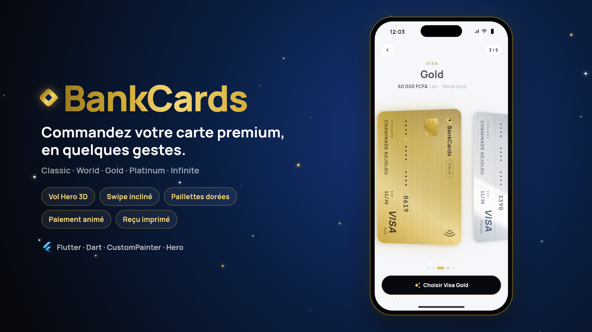
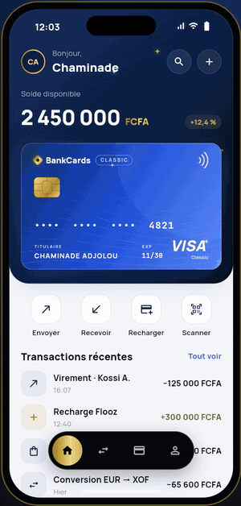
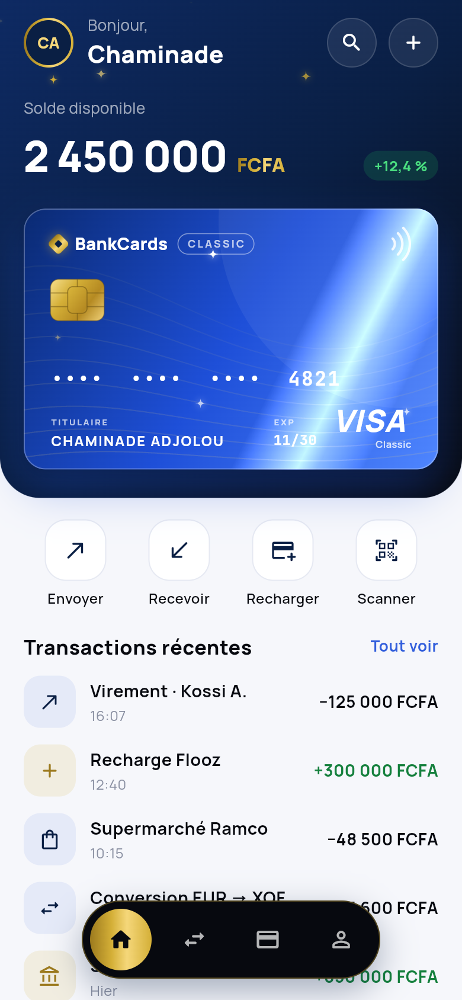
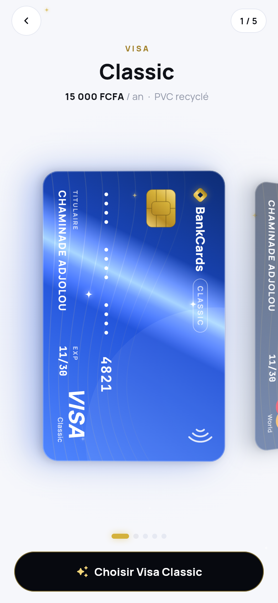
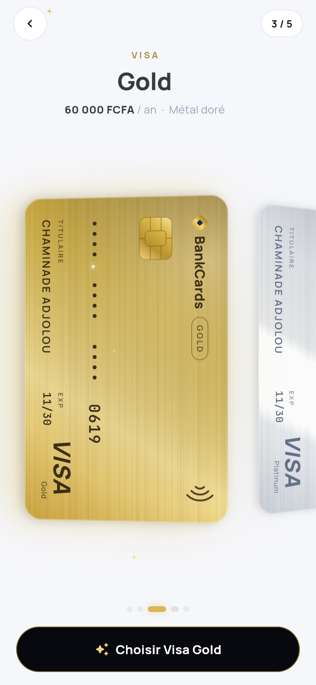
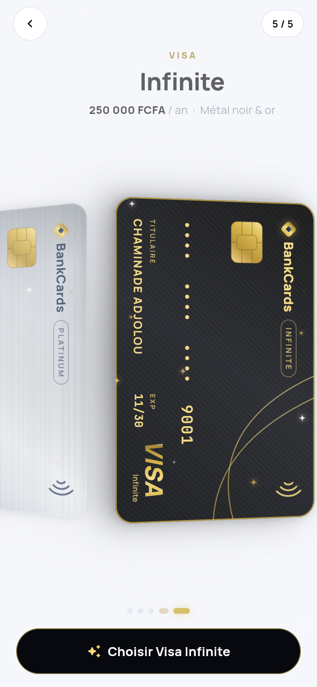
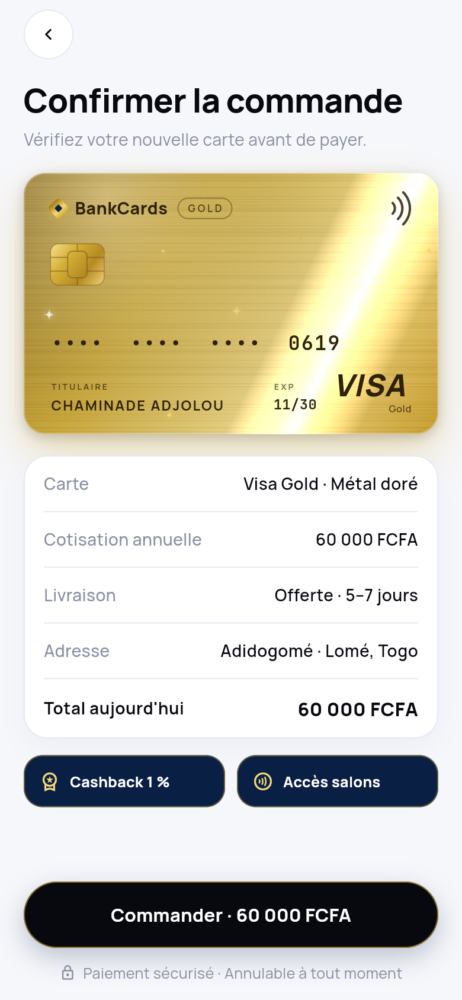
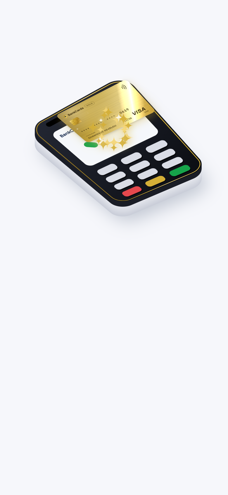
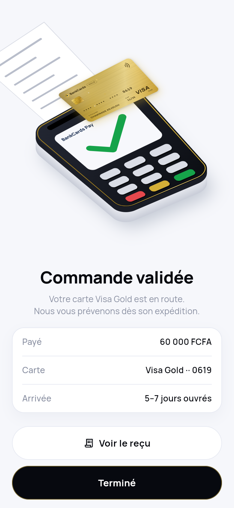
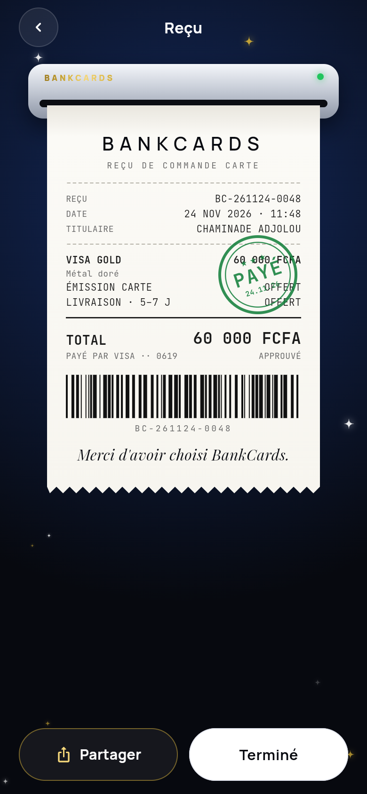

<div align="center">



# 💳 BankCards

**Commandez votre carte bancaire premium, en quelques gestes.**
Une app Flutter animée aux couleurs bleu · blanc · noir, avec des touches dorées et des paillettes ✨

[](https://bankcards-flutter.vercel.app)
[](https://github.com/Donchaminade/bankcards/releases/latest)
[](https://github.com/Donchaminade/bankcards/releases/latest)


</div>

---

## ✨ Aperçu

<div align="center">

</div>

| Accueil | Choix de la carte | Gold | Infinite |
|:---:|:---:|:---:|:---:|
|  |  |  |  |
| **Confirmation** | **Paiement** | **Commande validée** | **Reçu imprimé** |
|  |  |  |  |

🎬 Vidéos de démo : [`video/bankcards-linkedin-1920x1080.mp4`](video/bankcards-linkedin-1920x1080.mp4) (16:9) · [`video/bankcards-1080x1920.mp4`](video/bankcards-1080x1920.mp4) (9:16)

## 🎞️ Le parcours et ses animations

1. **Accueil (portefeuille)** : solde, carte actuelle, transactions récentes, barre de navigation flottante, paillettes dorées.
2. **Vol Hero 3D** : on touche la carte, elle se soulève et **pivote de 90°** (paysage → portrait) pour rejoindre l'écran de choix.
3. **Choix de la carte** : un carrousel où chaque carte **s'incline en 3D** pendant le glissement. Le titre et le prix glissent en fondu, le halo prend la couleur de la carte et l'indicateur doré s'étire.
4. **Confirmation** : la carte revient à l'horizontale (Hero). On peut **l'incliner au doigt**, et elle revient en place avec un effet ressort. Le bouton « Commander » se rétracte en pilule avec des points animés.
5. **Paiement** : la carte vole et **se pose à plat sur un terminal isométrique**. Elle tapote l'écran, une coche verte se dessine, une gerbe de paillettes éclate et le ticket sort.
6. **Commande validée** : le titre, les détails et les boutons apparaissent l'un après l'autre.
7. **Reçu** : une imprimante en métal **imprime le ticket ligne par ligne**, puis un **tampon « PAYÉ » s'abat** et les actions glissent en place.

## 💳 Les cartes

| Carte | Réseau | Finition | Couleurs |
|---|---|---|---|
| **Classic** | Visa | brillante, vagues lumineuses | bleu roi |
| **World** | Mastercard | brillante | bleu nuit |
| **Gold** | Visa | métal brossé | or |
| **Platinum** | Visa | acier brossé | argent |
| **Infinite** | Visa | métal noir, fibre carbone | noir et or |

Chaque carte a une puce dorée, le logo sans contact, le logo du réseau, un numéro masqué (`•••• 4821`, fictif), le nom du titulaire et la date d'expiration. Un **reflet doré balaie la carte** en continu et des **paillettes scintillent** à sa surface.

> Aucune vraie donnée bancaire : les numéros, les montants et le titulaire sont fictifs. Les logos des réseaux sont redessinés en code, pour la démo.

## 🛠️ Stack

- **Flutter 3.38 / Dart 3.10**, sans aucune dépendance externe
- `Hero` avec un `flightShuttleBuilder` sur mesure qui interpole la boîte, la rotation et l'inclinaison 3D
- `Matrix4` avec perspective (`rotateX`, `rotateY`, `rotateZ`) pour le carrousel, le terminal isométrique et l'inclinaison au doigt
- `CustomPainter` pour la puce, le sans contact, Mastercard, le métal brossé, la fibre carbone, le reflet, les paillettes, le terminal, le code-barres et le ticket dentelé
- `AnimationController` avec des `Interval` pour enchaîner les étapes, `AnimatedContainer` et `AnimatedSwitcher`
- Tests de widgets (`flutter test`) : catalogue, numéros masqués et parcours complet jusqu'au reçu

```
lib/
├── main.dart            # app + cadre téléphone sur grand écran
├── theme.dart           # charte bleu / blanc / noir / or
├── data.dart            # catalogue des cartes et transactions (fictives)
├── demo.dart            # mode démo auto (?demo=1) et transitions
├── screens/             # accueil, choix, confirmation, commande validée, reçu
└── widgets/             # carte, paillettes, terminal, composants UI
```

## 🚀 Lancer le projet

```bash
git clone https://github.com/Donchaminade/bankcards.git
cd bankcards
flutter pub get
flutter run            # mobile ou émulateur
flutter run -d chrome  # web
flutter test           # tests
```

Pour les builds :

```bash
flutter build apk --release      # Android
flutter build web --release      # Web (déployé sur Vercel)
flutter build ios --release --no-codesign   # iOS (sur macOS)
```

💡 Sur le web, ajoute **`?demo=1`** à l'URL pour que le parcours se joue tout seul : [bankcards-flutter.vercel.app/?demo=1](https://bankcards-flutter.vercel.app/?demo=1).

## 📱 Installer l'app

- **Android** : télécharge `BankCards-v1.0.1.apk` depuis la [dernière Release](https://github.com/Donchaminade/bankcards/releases/latest), puis autorise l'installation depuis des sources inconnues.
- **iPhone** : télécharge `BankCards-unsigned.ipa` depuis la [dernière Release](https://github.com/Donchaminade/bankcards/releases/latest).
  ⚠️ **L'IPA n'est pas signée**. Elle ne s'installe pas directement : il faut la signer avec ton identifiant Apple via **[AltStore](https://altstore.io)** ou **[Sideloadly](https://sideloadly.io)**. Avec un compte gratuit, l'app reste valable 7 jours.
  L'IPA est construite automatiquement par GitHub Actions sur macOS ([`.github/workflows/ios.yml`](.github/workflows/ios.yml)).

## 🙏 Crédits et licences

- **Inspiration** : la démo Flutter « Digital Wallet – Premium Card Ordering Experience » de **[Santhosh S](https://www.linkedin.com/in/santhosh-merndeveloper)**, publiée sur LinkedIn. BankCards en reprend le parcours et les effets, mais tout le code est réécrit, avec une nouvelle charte, cinq cartes et un tampon « PAYÉ » animé.
- **Illustrations** : toutes dessinées en code avec `CustomPainter` (terminal, cartes, imprimante, ticket, paillettes). Il n'y a aucune image tierce.
- **Polices** : [Manrope](https://fonts.google.com/specimen/Manrope), [JetBrains Mono](https://fonts.google.com/specimen/JetBrains+Mono) et [Playfair Display](https://fonts.google.com/specimen/Playfair+Display), toutes sous licence **SIL Open Font License 1.1**.
- **Icônes** : Material Icons (Apache 2.0).
- Visa et Mastercard sont des marques de leurs propriétaires respectifs. Elles sont utilisées ici à titre purement illustratif.

## ⭐ Star & Fork

Si BankCards te plaît, **laisse une ⭐** sur le dépôt et **fais un fork** pour l'adapter à ta banque ou à ta fintech. Les PR sont les bienvenues !

## 📄 Licence

[MIT](LICENSE) © 2026 [Donchaminade](https://github.com/Donchaminade)
